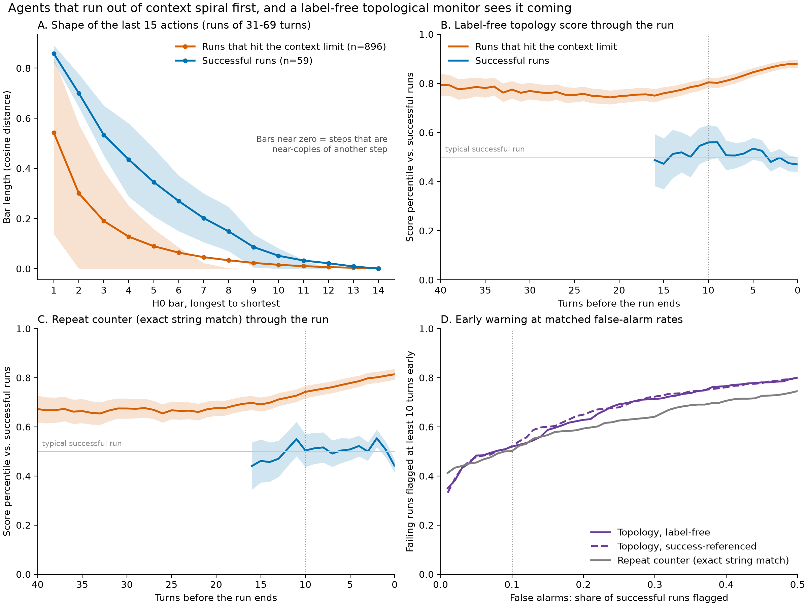

# Agents Spiral Before They Run Out of Context

**A label-free topological monitor that flags SWE agents heading for context exhaustion ~16 turns early.**

Project page: **https://joshuadebellis.github.io/agent-spiral-monitor/**

When software-engineering agents exhaust their context window, they don't fail suddenly; they spiral. The same edit retried five times, two files opened alternately, `ls` run over and over. This project measures that spiral with persistent homology on embeddings of the agent's own actions, and asks how early it can be seen.

| Finding | Result |
|---|---|
| Late collapse separates failing from successful runs (length-matched, fresh data) | AUC **0.885** from the topology score alone |
| Adds beyond length + hand-built repetition features | **+0.017** AUC [0.008, 0.027], pre-registered, replicated, 5/5 seeds |
| Early warning, label-free, at 10% false alarms on successful runs | **75%** of doomed runs flagged, median **16 turns** before the cutoff |
| vs. a repeat counter designed after inspecting failures | **tie** per run; better per window (AUC 0.81 vs 0.68) |
| Confidently wrong runs | **no distinctive shape** (null across three datasets) |

## Method

Data: [`nebius/SWE-agent-trajectories`](https://huggingface.co/datasets/nebius/SWE-agent-trajectories), SWE-agent runs from `swe-agent-llama-70b`. Outcome groups: **success** (resolved, submitted), **hit_limit** (unresolved, exited on context), **wrong** (unresolved, submitted normally).

```
agent turns → split into reasoning / action / observation text
→ embed each step (all-MiniLM-L6-v2) → 15-turn windows (first / last / evenly spaced / rolling)
→ persistence diagrams → persistence images → kNN distance to reference windows
```

- **Rips H0** (cosine distance): how the steps cluster. Near-copies merge instantly, so a spiral collapses.
- **Path-complex H1:** consecutive steps joined at zero distance, so every H1 bar is a return to an earlier state.
- **Anomaly score:** mean distance to the 10 nearest reference windows. References are either known-successful runs or, in the label-free version, the first 15 turns of *any* run.

## Results

### 1. The failure mode: spiraling
In the last 15 actions of runs that hit the context limit, the H0 bars collapse: most steps are near-copies of another step. Inspecting the endings directly confirms literal loops: repeated identical edits, A-B-A-B file toggling, repeated directory listings.

### 2. Pre-registered confirmation on fresh trajectories
Four tests were fixed in advance, then run on a new sample with every first-sample trajectory excluded by hash. Baseline = log(turns) + 12 repetition features (unique-step share, top-step share, A-B-A-B rate, consecutive word overlap).

| Test | Gain over length + repetition | Verdict |
|---|---|---|
| P1: last-window action collapse (runs of 31–69 turns) | **+0.017 [0.008, 0.027]** | **PASS** (5/5 seeds) |
| P2: mid-run reasoning loops | +0.002 | fail |
| P3: first-15-turn early warning | +0.002 | fail |
| P4: wrong answers vs success | −0.023 | fail |

### 3. The spiral comes first
Repetition in hit-limit runs vs successes, by fraction of the run's total text used so far:

| Context used | hit_limit | success |
|---|---|---|
| 0–25% | 0.19 | 0.06 |
| 25–50% | 0.42 | 0.11 |
| 50–75% | 0.56 | 0.16 |
| 75–100% | 0.63 | 0.21 |

Doomed runs already repeat 3× as often in the first quarter of context: the loop precedes the limit, then worsens as context fills.

### 4. Early warning, without labels
A rolling 15-turn topology score along each run, compared at matched false-alarm rates on successful runs (held-out tasks):

| Detector (10% false alarms) | Runs flagged | Flagged ≥10 turns early | Median lead | Window AUC |
|---|---|---|---|---|
| Topology, reference = known successes | 0.76 | 0.52 | 16 turns | 0.787 |
| **Topology, reference = run starts (no labels)** | **0.75** | **0.52** | **16 turns** | **0.806** |
| Topology, reference = the run's own start | 0.74 | 0.48 | 15 turns | 0.811 |
| Repeat counter (exact string match) | 0.71 | 0.50 | 15 turns | 0.683 |

Run-level differences are within bootstrap noise. The label-free monitor matches a repetition detector that only exists because someone inspected the failures first, and separates individual windows better.



## Negative results

- **ProcessBench** (math reasoning steps): persistent homology adds nothing beyond length at step, sentence or word level.
- **nvidia/Open-SWE-Traces:** unusable for this question. Every run in it called `finish` and produced a patch.
- **Confidently wrong runs** look like successful ones in every dataset tried.
- **Total characters** nearly *defines* hitting the limit, so P1's gain over a character-count baseline is not significant. The useful claim is forecasting, not classifying finished runs.

## Reproduce

```powershell
uv sync
uv run python build_nebius_anomaly.py config_nebius.yaml; if ($?) { uv run python add_repetition.py config_nebius.yaml }; if ($?) { uv run python build_nebius_anomaly.py config_nebius_confirm.yaml }; if ($?) { uv run python add_repetition.py config_nebius_confirm.yaml }; if ($?) { uv run python repetition_eval.py config_nebius_confirm.yaml }; if ($?) { uv run python seed_check.py config_nebius_confirm.yaml }; if ($?) { uv run python context_check.py config_nebius_confirm.yaml }; if ($?) { uv run python alarm_curve.py config_nebius_confirm.yaml }; if ($?) { uv run python label_free.py config_nebius_confirm.yaml }; if ($?) { uv run python make_figures.py config_nebius_confirm.yaml }
```

| Script | Role |
|---|---|
| `trace_features.py` | distance matrices, path complex, persistence features |
| `anomaly_eval.py` | persistence images, kNN/prototype anomaly scores, bootstrap |
| `build_nebius_anomaly.py` | stream trajectories, embed, window, persistence diagrams |
| `anomaly_eval_nebius.py`, `reanalyze_nebius.py`, `peek_endings.py` | exploratory scan, length-matched bands, inspecting endings |
| `add_repetition.py`, `repetition_eval.py`, `seed_check.py` | repetition baseline, pre-registered tests, seed stability |
| `context_check.py`, `alarm_curve.py`, `label_free.py` | context-limit checks, matched-false-alarm curves, label-free monitors |
| `make_figures.py` | the figure |
| `exploratory/` | ProcessBench and Open-SWE experiments (run with `$env:PYTHONPATH="."`) |

## License

- **Code:** [PolyForm Noncommercial 1.0.0](https://polyformproject.org/licenses/noncommercial/1.0.0/)
- **Text and figures:** [CC BY-NC 4.0](https://creativecommons.org/licenses/by-nc/4.0/)

For commercial licensing, contact the author.

## Author

Joshua DeBellis, mathematical physicist and data scientist. See also: [Spectral Fingerprints of AI Music Generators](https://joshuadebellis.github.io/ai-music-fingerprints/).